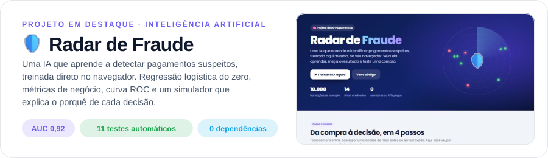
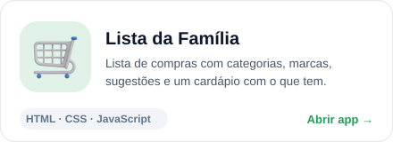
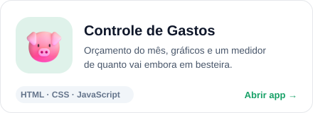
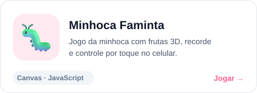
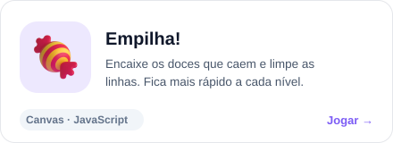
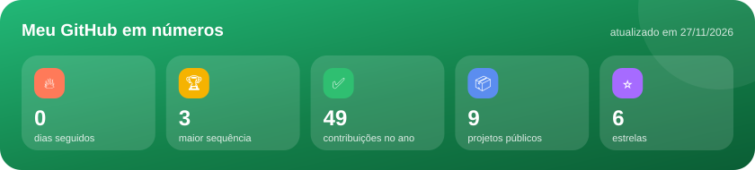

### Sobre mim

- 🛠️ Crio **apps web** que resolvem problemas do dia a dia de um jeito simples: abrem no navegador, sem instalar nada e sem cadastro.
- 🧠 Estudo **inteligência artificial aplicada a pagamentos e risco**, escrevendo os modelos do zero para entender como funcionam por dentro.
- 🎮 Nas horas vagas, faço **jogos para o navegador**.
- 🌱 Gosto de projeto bem acabado: visual caprichado, testes automáticos e README explicando o porquê das decisões.

### Projeto em destaque

<a href="https://rico2978bg-hub.github.io/radar-fraude/">
  <picture>
    <source media="(prefers-color-scheme: dark)" srcset="cartoes/radar-fraude-escuro.svg">
    
  </picture>
</a>

🔗 [Abrir o projeto](https://rico2978bg-hub.github.io/radar-fraude/) · [Código e como funciona](https://github.com/rico2978bg-hub/radar-fraude)

### Projetos

<a href="https://rico2978bg-hub.github.io/lista-compras/"><picture><source media="(prefers-color-scheme: dark)" srcset="cartoes/lista-compras-escuro.svg"></picture></a>
<a href="https://rico2978bg-hub.github.io/controle-gastos/"><picture><source media="(prefers-color-scheme: dark)" srcset="cartoes/controle-gastos-escuro.svg"></picture></a>
<a href="https://rico2978bg-hub.github.io/minhoca-faminta/"><picture><source media="(prefers-color-scheme: dark)" srcset="cartoes/minhoca-faminta-escuro.svg"></picture></a>
<a href="https://rico2978bg-hub.github.io/empilha/"><picture><source media="(prefers-color-scheme: dark)" srcset="cartoes/empilha-escuro.svg"></picture></a>

### Ferramentas

### Em números

As estatísticas se atualizam sozinhas todo dia. Capa e cartões gerados por [um script](scripts/cartoes_perfil.py) deste repositório.
